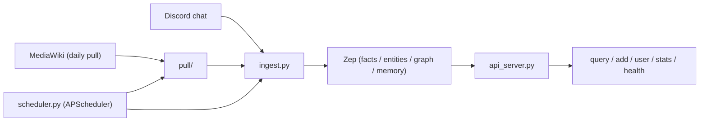

# bruggy-memory

Discord + wiki memory service for **Bruggy** — a Zep-backed RAG pipeline that
ingests Discord chat, pulls and chunks the wiki daily, and answers questions
across both with full provenance.

**Current Build:** `0.1.0`

> Versioning mirrors `discord-brussy-forever`: the build number auto-increments on
> every push to `main` via `.github/workflows/build-number.yml`. The latest
> build number lives in [`.github/build-number.txt`](.github/build-number.txt).

---

## What it does

- **Ingest chat** from Discord and **ingest wiki** from MediaWiki, routing each
  into Zep with source-specific metadata (design §3.2 / §3.3).
- **Pull the wiki daily** (`pull/` layer) — a MediaWiki client with a browser
  user-agent + Cloudflare backoff, a section-aware token chunker, per-page
  `revid` watermarking for incremental pulls, and a per-run export artifact.
- **Merge + recall**: dedupe, drop short segments, RAG query across chat + wiki
  with provenance on every result.
- **Schedule**: a daily pull + a catch-up run on restart, via APScheduler
  (`scheduler.py`).

## Architecture



## Repo layout

```
.
├── README.md
├── docker-compose.yaml
├── src/
│   ├── main.py            # CLI entrypoint (pull | catch-up | health | serve)
│   ├── scheduler.py       # APScheduler: daily pull + catch-up on boot
│   ├── api_server.py      # FastAPI REST layer
│   ├── ingest.py          # ingest + merge (chat + wiki)
│   ├── zep_client.py      # Zep v2 REST client + local embeddings
│   ├── in_memory_backend.py
│   ├── config.py          # Settings (env + src/config.sample JSON)
│   ├── logging_setup.py
│   ├── utils.py
│   ├── wikis.yaml         # selectable wiki pull sources
│   ├── config.sample      # JSON runtime config (app side)
│   └── pull/              # MediaWiki ingestion package
│       ├── wiki_client.py # UA + Cloudflare backoff + section extraction
│       ├── chunker.py     # WikiChunk + chunk_page
│       ├── watermark.py   # per-page revid watermark (data/watermark.json)
│       ├── pull_job.py    # orchestrates pull + chunk + watermark + export
│       └── export.py      # per-run export artifact (JSON + manifest)
├── config/
│   ├── settings.sample.md # tunables template (settings.md fallback)
│   ├── settings.md        # active settings
│   └── schema.sql         # local state (watermark / pull_status / outbox)
├── env/
│   └── .env.example       # secrets + config (gitignored .env)
├── tests/                 # pull + ingest + e2e tests (run via pyproject)
├── docs/
│   ├── api.md             # published API documentation
│   └── openapi.json       # auto-generated OpenAPI spec
├── build/
│   └── build-history.md   # Build History table
├── requirements.txt
├── src/Dockerfile
├── update_bot.sh
└── .github/workflows/build-number.yml
```

## Setup

### Docker (recommended)

```bash
cp env/.env.example .env        # fill in secrets
docker compose up --build
```

Brings up `bruggy-memory` plus the Zep stack (`zep-api`, `zep-nlp-server`,
`zep-postgres`, `zep-valkey`) on the `brussy-net` bridge network. API on
`http://localhost:8000`.

### Local / dev

```bash
pip install -r requirements.txt
# point ZEP_API_URL at your Zep instance, then:
cd src
python main.py serve            # API + scheduler
python main.py health           # liveness
python main.py pull             # one-time pull run
python main.py catch-up         # incremental catch-up from watermark
```

## Testing

```bash
pip install -r requirements.txt
pytest          # runs the pull package (~54), ingest (24), and e2e tests
```

Tests run entirely offline against a stub MediaWiki source and a stub Zep
backend — no network or secrets required. The e2e test does a full
**artifact-gen run** against the stub source.

## Versioning

- Semantic-ish bump per `main` push; the build number is stored in
  `.github/build-number.txt`.
- `APP_VERSION` is baked into the image via `docker build --build-arg
  APP_VERSION=<sha>`.
- Deploy with `./update_bot.sh` (builds, pushes to `ghcr.io/clintshed`, and
  prints the host-side pull + recreate command).

## API

Published API docs: **[docs/api.md](docs/api.md)** · OpenAPI:
[docs/openapi.json](docs/openapi.json) · interactive: `/docs` when serving.

## License

Private — clintshed.
